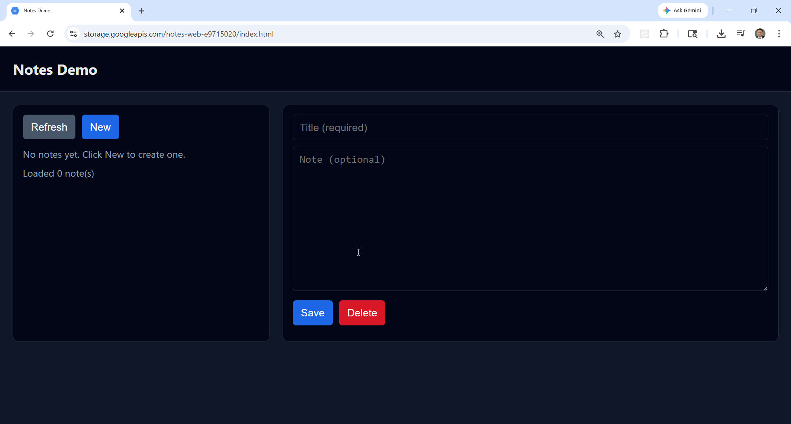
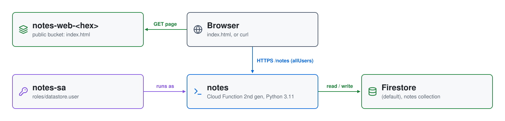

# Serverless CRUD API on GCP: Cloud Functions and Firestore

A small serverless **notes** API with a browser front end. One
second-generation **Cloud Function** serves all five CRUD endpoints, routing
by method and path itself, and stores notes in **Firestore**. A single-page
web app, served from a public **Cloud Storage** bucket, calls the API from
the browser.



| Piece | Where | Role |
|---|---|---|
| **notes** | Cloud Functions, `us-central1` | 2nd gen, Python 3.11, 60 s timeout; entry point `notes`; `run.invoker` granted to `allUsers`; CORS allows any origin |
| **notes-sa** | IAM | the function's service account, with `roles/datastore.user` |
| **notes-src-&lt;hex&gt;** | Cloud Storage, `US` | the function's source zip, named by its MD5 so a code change redeploys |
| **Firestore** | `us-central1` | native mode `(default)` database, created by `api_setup.sh`; `notes` collection, one document per note |
| **notes-web-&lt;hex&gt;** | Cloud Storage, `US` | public-read bucket holding `index.html` and `favicon.ico` |

## Architecture

<picture>
  <source media="(prefers-color-scheme: dark)" srcset="architecture-dark.svg">
  
</picture>

Regenerate with `python3 make_diagram.py`.

- **`01-functions/`**: `main.tf` (the service account and its role, the
  source bucket, the function and its public invoker binding) and the code
  in `notes/main.py`.
- **`02-webapp/`**: the web bucket and its public-read binding, and
  `index.html.tmpl`, which `apply.sh` fills in with the API URL.

## API

The base URL is `https://us-central1-<project>.cloudfunctions.net`; the
function is `notes`, and it reads everything after `/notes` as the note ID.
There's no authentication. Every note
gets the hardcoded owner `"global"`, and listing queries on it.

| Method | Path | Returns |
|---|---|---|
| POST | `/notes` | `201` `{id, title, note}`; `400` if `title` or `note` is missing |
| GET | `/notes` | `{"items": [...]}` |
| GET | `/notes/{id}` | the note, or `404` |
| PUT | `/notes/{id}` | the updated note; `400` if `title` or `note` is missing, `404` if it doesn't exist |
| DELETE | `/notes/{id}` | `200`, or `404` if it doesn't exist |

Each note gets a UUID `id`, used as the document ID, and `created_at` /
`updated_at` timestamps.

```bash
curl -s -X POST https://us-central1-<project>.cloudfunctions.net/notes \
  -H "Content-Type: application/json" \
  -d '{"title":"Test Note 1","note":"This is test note 1"}'
```

## Prerequisites

* [A Google Cloud Account](https://console.cloud.google.com/)
* [Install gcloud CLI](https://cloud.google.com/sdk/docs/install)
* [Install Terraform](https://developer.hashicorp.com/terraform/install)
* [Install jq](https://jqlang.github.io/jq/download/) and `envsubst`

Put a service account key in the repository root as `credentials.json`. If
this is your first time following along, we recommend starting with this
video: [GCP + Terraform: Easy Setup](https://youtu.be/3spJpYX4f7I).

## Deploy

```bash
git clone https://github.com/mamonaco1973/gcp-crud-example.git
cd gcp-crud-example
./apply.sh
```

`check_env.sh` runs `api_setup.sh`, which signs in with `credentials.json`,
enables the APIs, and creates the Firestore database if it doesn't exist.
`apply.sh` then applies `01-functions`, renders `02-webapp/index.html` from
the template with `envsubst`, and applies `02-webapp`. It ends by running
`validate.sh`, which creates five notes, lists them, fetches, updates and
deletes each one, retrying while the function comes up:

```
NOTE: Created note 1 (id=2f2d0c5a-9f5f-4d7d-9e2c-1c8a5b8e3c21)
...
NOTE: List endpoint returned 5 notes
...
NOTE: Deleted note 2f2d0c5a-9f5f-4d7d-9e2c-1c8a5b8e3c21

  Deployment validated!

  API : https://us-central1-my-project.cloudfunctions.net/notes
  Web : https://storage.googleapis.com/notes-web-<hex>/index.html
```

## Try it

1. Open the **Web** URL and add, edit and delete notes in the page.
2. Or use `curl` against the **API** URL with the routes above.

## Teardown

```bash
./destroy.sh
```

`destroy.sh` first deletes every note through the API, because Terraform
doesn't manage the Firestore database or its documents; the empty database
stays in the project.

## Notes

- **Lab only.** Anyone can call the function, CORS allows any origin, and
  the web bucket is public.
- `.gitignore` doesn't list `credentials.json`, so take care not to commit
  your key.
- `check_env.sh` doesn't check for `envsubst`, which `apply.sh` needs.
